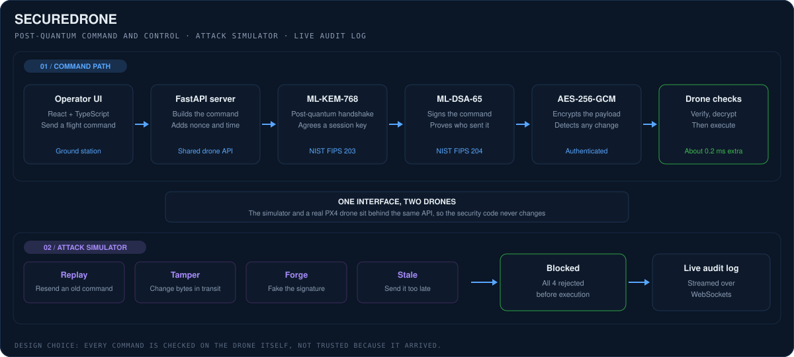
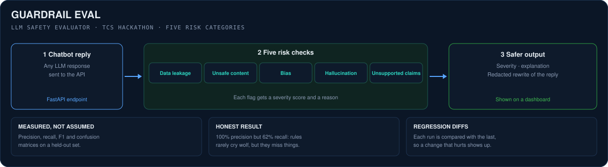

  
   
   
  
  
  
  

 

## 👋 About Me

I'm Yashi, an Information Technology student at D. J. Sanghvi College of Engineering in Mumbai. I'm a full stack developer at heart, and the question I keep coming back to is a simple one: when software acts on its own, how do we know it did the right thing?

That question is what pulled me towards **agentic AI**. An agent that plans and calls tools is only as useful as it is trustworthy, so I'm most interested in the parts around the model: checking what it outputs, making sure its actions are allowed and verified, and keeping a record of what actually happened.

At **Twwios Technologies** I worked as a full stack developer intern on a live booking platform, which taught me how much a small bug in a booking or payment flow matters to a real user. On my own, I built **SecureDrone**, where every drone command is signed and encrypted with post-quantum cryptography, and **Guardrail Eval**, an evaluator that checks chatbot replies for risky content.

Outside code, I'll happily talk to anyone, which is probably why I enjoy committee work and hackathons so much. You'll also find me playing badminton or trying whatever new thing has caught my attention that week.

 

  <table>
    <tr>
      <td align="center" width="33%"><h3>🤖 Agentic AI</h3>Tool use, guardrails, evals and safe actions</td>
      <td align="center" width="33%"><h3>🧱 Full stack</h3>React, FastAPI, REST APIs and payment flows</td>
      <td align="center" width="33%"><h3>🔐 Secure systems</h3>Signed commands, encryption and audit logs</td>
    </tr>
  </table>

---

## 💼 Experience & Leadership

<table>
  <tr>
    <td width="24%" valign="top">
      <h3>Twwios Technologies</h3>
      <b>Full Stack Developer Intern</b> 
      Jul 2026 to Aug 2026  
      
    </td>
    <td valign="top">
      I worked on <a href="https://lastminutessdeal.com">Last Minutes Deal</a>, a platform for last-minute hotel, villa and buffet deals. I built the customer web app in React 19 and Vite, which grew to 11 routes and about 7,000 lines of code, and connected it to the company's REST APIs through Axios.
        
      The core of the work was the booking journey: search, details, booking and payment for stays, plus a separate flow for buffets, with Cashfree checkout at the end. I also added Google sign-in with Firebase Auth, a currency selector for INR, USD, EUR and GBP that remembers the user's choice, a reviews section and infinite scroll. Several of my fixes were for booking-date, login and villa pricing bugs, which I worked through on Git branches and pull requests with the rest of the team.
        
      <b>What this taught me:</b> a feature isn't finished when it works on my screen. It's finished when the dates, prices and logins are right for every user who goes through it.
        
      <code>React 19</code> <code>Vite</code> <code>REST APIs</code> <code>Axios</code> <code>Firebase Auth</code> <code>Cashfree</code> <code>Git</code>
    </td>
  </tr>
  <tr>
    <td width="24%" valign="top">
      <h3>DJS Trinity</h3>
      <b>Publicity Co-Committee</b> 
      Sep 2025 to Jul 2026  
      
    </td>
    <td valign="top">
      As part of the publicity team for DJSCE's cultural committee, I helped get the word out about our events and get people to actually show up. Most of it is about knowing your audience and following up on the small details nobody else notices.
    </td>
  </tr>
  <tr>
    <td width="24%" valign="top">
      <h3>DJS E-Cell</h3>
      <b>Events Co-Committee</b> 
      Oct 2024 to Oct 2025  
      
    </td>
    <td valign="top">
      I helped plan and run events for the Entrepreneurship Cell. Working on events taught me to plan for things going wrong, which turns out to be a very useful habit when building software too.
    </td>
  </tr>
</table>

---

## 🚀 Featured Project: SecureDrone

  
  
  

**A drone controller that only obeys commands it can prove are real, even against a future quantum attacker.**

A drone that accepts any command it receives is a drone anyone can fly. I wanted to see what it takes to make every single command verifiable, so each one is signed and encrypted with the new NIST post-quantum standards, and the drone checks it before it moves. To make sure the protection actually works, I also built an attack simulator into the app that tries to break it.

  

### How the system works

| Module | What happens | Why it's built this way |
|---|---|---|
| **Key exchange** | The ground station and drone agree a session key with an ML-KEM-768 handshake. | Classic key exchange could be broken by a future quantum computer. ML-KEM is the new NIST standard (FIPS 203). |
| **Signing** | Every command is signed with ML-DSA-65. | The drone needs to know who sent a command, not just that it arrived. |
| **Encryption** | The payload is encrypted with AES-256-GCM under the session key. | GCM both hides the command and detects if even one byte was changed. |
| **Drone-side checks** | Four checks reject replayed, tampered, forged and stale commands. | Checking on the drone means a command is never trusted just because it reached the drone. |
| **Attack simulator** | The app can fire all four attacks on demand. | It's easy to claim something is secure. Showing each attack being blocked is better proof. |
| **Audit log** | Every blocked attack streams to a live log over WebSockets. | If something is attacked, you should be able to see it happen, not find out later. |
| **One drone API** | A simulator and a real PX4 drone sit behind the same interface. | The security code is tested once and works for both. |
| **Tests and speed** | 33 pytest tests run in GitHub Actions against the real liboqs library. The added cost is about 0.2 ms per command. | Security that slows a drone down won't get used, so I measured the overhead instead of guessing. |

**Stack:** Python, FastAPI, React, TypeScript, liboqs, AES-256-GCM, WebSockets, pytest, GitHub Actions.

[Explore the code in the repository](https://github.com/yashishah176/SecureDrone)

---

## 🧩 More Projects

### 01. Guardrail Eval · TCS Hackathon

  

Chatbots sometimes say things they shouldn't: leaking data, making things up, or answering with bias. Guardrail Eval is an API and dashboard that checks a chatbot's reply for **data leakage, unsafe content, bias, hallucination and unsupported claims**. Each flag comes with a severity score, a short explanation and a redacted, safer version of the reply.

The part I'm proudest of is how it was measured. I scored it with precision, recall, F1 and confusion matrices, and compared runs to catch regressions. On a held-out set it reached **100% precision but 62% recall**. In plain words, when it flags something it's right, but it still misses things. That result showed me exactly where simple rule-based checks run out, which is the same problem anyone building guardrails for agents has to solve.

**Stack:** Python, FastAPI, JavaScript.

[Explore the code in the repository](https://github.com/yashishah176/Guardrail-Eval)

### 02. Last Minutes Deal · Internship

The customer website for a live booking platform, built during my internship at Twwios. It covers hotel, villa and buffet bookings from search to Cashfree payment, Google sign-in, multi-currency pricing and infinite scroll. The details are in the experience section above.

**Stack:** React 19, Vite, Axios, Firebase Auth, Cashfree. · [Visit the live site](https://lastminutessdeal.com)

### 03. AI Traffic System · In progress

I'm currently building an AI-based traffic system with [Akshat](https://github.com/AKSHAT200905). The idea is to detect traffic violations from camera footage and use what's happening on the road to help signals adapt. I'll add the repository here once it's ready.

---

## 🏆 Achievements & Certifications

- **2nd Runner-Up**, Oscillation 3.0 Ideathon
- **TCS Hackathon**: built Guardrail Eval
- **Certifications:** Agentic AI and AI Agents · Build an AI Travel Agent App with OpenAI · Data Processing and Optimization with Generative AI · Data Warehousing and Business Intelligence

---

## 🐍 GitHub Contribution Snake

  

  
  

---

## 🛠️ Technical Skills

  

| Area | Tools and concepts I've worked with |
|---|---|
| **Languages** | Python, JavaScript, TypeScript, Java, C, SQL, HTML, CSS |
| **Frontend** | React, Vite, Tailwind CSS, Firebase Auth |
| **Backend** | FastAPI, Pydantic, REST APIs, WebSockets |
| **AI and data** | LLM guardrails and evaluation, NumPy, Pandas, scikit-learn |
| **Security** | Post-quantum cryptography (ML-KEM, ML-DSA), AES-GCM, replay and tamper protection |
| **Tooling** | Git, GitHub Actions, pytest, Linux/WSL, VS Code, Figma |

---

## 🌱 What I'm Exploring

- **Agentic AI:** how agents plan, choose tools and recover when a step fails.
- **Guardrails and evals:** better ways to check what an agent says and does, and to measure where it fails.
- **Safe actions:** giving agents only the permissions they need, and making every action verifiable and logged.
- **Tool calling and MCP:** how agents connect to real apps and data.

## 📬 Connect

I'm always happy to talk about agentic AI, full stack projects, hackathons, or anything new you're building. And if you need one more person for a hackathon team or a badminton game, I'm in.

  
  
  

 

  Built with curiosity, a lot of questions, and one bug fix at a time.

