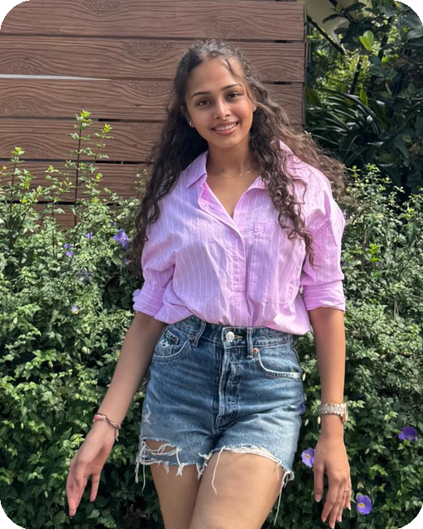

## 

I'm a full stack developer in the making, and I'm the kind of person who will happily talk to anyone and try anything new. That curiosity is how I ended up building across the stack: React frontends, FastAPI services and real booking and payment flows. Right now I'm pointing it at **agentic AI**: systems that plan, call tools and take real actions, and how to make sure those actions are safe, verified and traceable.

Here is the short version of what I've done:

- Interned as a **Full Stack Developer at Twwios Technologies** (Jul to Aug 2026): built the customer web app for **lastminutessdeal.com**, with booking and payment flows on top of the company's REST APIs.
- Built **SecureDrone**, where every command is signed and encrypted with **NIST post-quantum cryptography**, and all **4 attack types** I simulated were blocked.
- Built **Guardrail Eval** at the **TCS Hackathon**, an LLM safety evaluator that hit **100% precision** on a held-out set.
- **2nd Runner-Up at the Oscillation 3.0 Ideathon**.
- Currently building an **AI traffic system** with [Akshat](https://github.com/AKSHAT200905).

Open to full stack and AI internships, and always up for a hackathon team or a game of badminton.

### Focus areas

<table>
<tr>
<th align="left">Full stack products</th>
<th align="left">Agentic AI exploration</th>
<th align="left">Secure systems</th>
</tr>
<tr>
<td valign="top">React, Vite, FastAPI, Firebase Auth, REST APIs, payment flows</td>
<td valign="top">Tool use, multi-step workflows, guardrails, evals</td>
<td valign="top">Signed and verified actions, replay protection, audit logs</td>
</tr>
</table>

## 

| Practice | Where I've done it | Why it matters for agents |
| :-- | :-- | :-- |
| Signed, verified actions | SecureDrone signs every command with ML-DSA-65 and checks it before it runs | An agent's tool calls should be verified, not just trusted |
| Replay and freshness checks | SecureDrone rejects replayed and stale commands | An old or injected instruction should never run twice |
| Output guardrails | Guardrail Eval flags leaks, unsafe content, bias and hallucinations | Agent output must be checked before it reaches a user or a tool |
| Honest evaluation | Guardrail Eval: precision, recall, F1 and run-to-run diffs | Agents need evals that show where they fail, not just demos |
| Audit logs | SecureDrone streams every blocked attack to a live log | Every agent action should be traceable and reviewable |
| Automated testing | SecureDrone: 33 pytest tests in GitHub Actions | Behaviour changes should be caught before they ship |

This is the lens I bring to agentic AI: an agent is only as useful as it is trustworthy.

## 

**Full Stack Developer Intern · Twwios Technologies (Last Minutes Deal)** 
Jul 2026 to Aug 2026 · Mumbai

- Built the customer web app for a last-minute hotel, villa and buffet deals platform in React 19 and Vite: 11 routes and about 7,000 lines of code.
- Built end-to-end booking flows for stays and buffets with Cashfree checkout, integrated with the company's REST APIs through Axios.
- Added Google sign-in with Firebase Auth, a persistent multi-currency selector (INR, USD, EUR, GBP), a reviews section and infinite scroll.
- Fixed booking-date, auth and pricing bugs through Git branches and pull requests in a multi-developer team.

## 

<table>
<tr>
<td width="50%" valign="top">

<h3>SecureDrone</h3>

Post-quantum drone command and control

<ul><li>Signs every command with ML-DSA-65 and encrypts it with AES-256-GCM under an ML-KEM-768 session key.</li><li>Drone-side checks block replay, tampering, forged signatures and stale commands, shown live in an attack simulator.</li><li>One API for a simulator and a real PX4 drone; about 0.2 ms overhead per command; 33 tests in CI.</li></ul>

<code>FastAPI</code> <code>React</code> <code>liboqs</code>

<a href="https://github.com/yashishah176/SecureDrone">Explore repository →</a>
</td>
<td width="50%" valign="top">

<h3>Guardrail Eval</h3>

LLM safety evaluator · TCS Hackathon

<ul><li>Flags chatbot replies for data leakage, unsafe content, bias, hallucination and unsupported claims.</li><li>Gives each flag a severity score, an explanation and a redacted rewrite.</li><li>Scored with precision, recall, F1 and confusion matrices: 100% precision, 62% recall on a held-out set.</li></ul>

<code>Python</code> <code>FastAPI</code> <code>Evals</code>

<a href="https://github.com/yashishah176/Guardrail-Eval">Explore repository →</a>
</td>
</tr>
<tr>
<td width="50%" valign="top">

<h3>Last Minutes Deal</h3>

Live booking platform · Internship

<ul><li>Customer web app for last-minute hotel, villa and buffet deals.</li><li>Search, booking and Cashfree payment flows wired to REST APIs.</li><li>Google sign-in, multi-currency pricing and infinite scroll.</li></ul>

<code>React 19</code> <code>Firebase</code>

<a href="https://lastminutessdeal.com">Visit live site →</a>
</td>
<td width="50%" valign="top">

<h3>AI Traffic System</h3>

In progress · with Akshat

<ul><li>Detects traffic violations from camera footage.</li><li>Uses live traffic to help signals adapt their timing.</li><li>Computer vision and ML, built as a team.</li></ul>

<code>Computer vision</code> <code>ML</code>

Repository coming soon
</td>
</tr>
</table>

Project metrics describe different measures, not a shared ranking. Segments represent attack types, risk categories, routes or modules.

## 

- **2nd Runner-Up · Oscillation 3.0 Ideathon**
- **TCS Hackathon**: built Guardrail Eval.
- **Certifications**: Agentic AI and AI Agents · Build an AI Travel Agent App with OpenAI · Data Processing and Optimization with Generative AI · Data Warehousing and Business Intelligence.

## 

- Agent architectures: planning, tool use and memory
- Tool calling and MCP servers
- Guardrails and evals for LLM applications
- Secure, permissioned actions for agents that act in the real world

## 

 

| Area | Skills |
| :-- | :-- |
| Languages | Python, JavaScript, TypeScript, Java, C, SQL, HTML/CSS |
| Frameworks & libraries | React, FastAPI, Tailwind CSS, Vite, Firebase, Pydantic |
| Tools | Git, GitHub Actions, pytest, Linux/WSL, VS Code, Figma |
| Other | REST APIs, WebSockets, applied cryptography, NumPy, Pandas, scikit-learn |

## 

**B.Tech in Information Technology** 
Dwarkadas J. Sanghvi College of Engineering (DJSCE), Mumbai 
2024 to 2028 · **CGPA 8.66**

| Community | Role | Period |
| :-- | :-- | :-- |
| DJS Trinity (Cultural Committee) | Publicity Co-Committee | Sep 2025 to Jul 2026 |
| DJS E-Cell (Entrepreneurship Cell) | Events Co-Committee | Oct 2024 to Oct 2025 |

## 

<picture>
<source media="(prefers-color-scheme: dark)" srcset="https://raw.githubusercontent.com/yashishah176/yashishah176/output/github-contribution-grid-snake-dark.svg?v=1" />

</picture>

### Let's connect

Happy to talk about full stack, agentic AI, hackathons, badminton, or whatever new thing I'm into this week.

